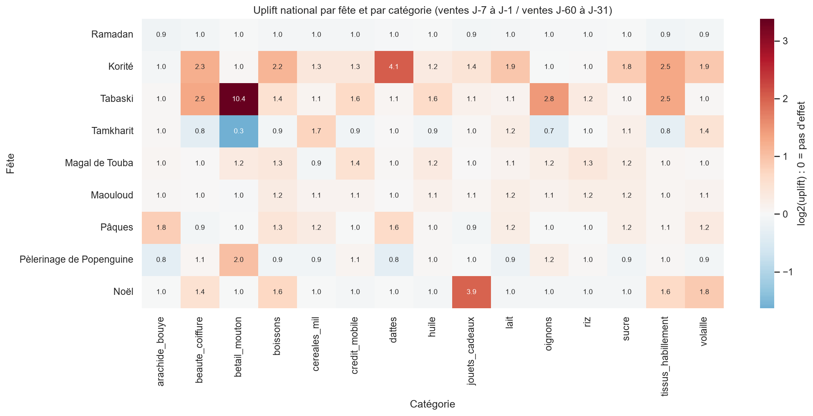
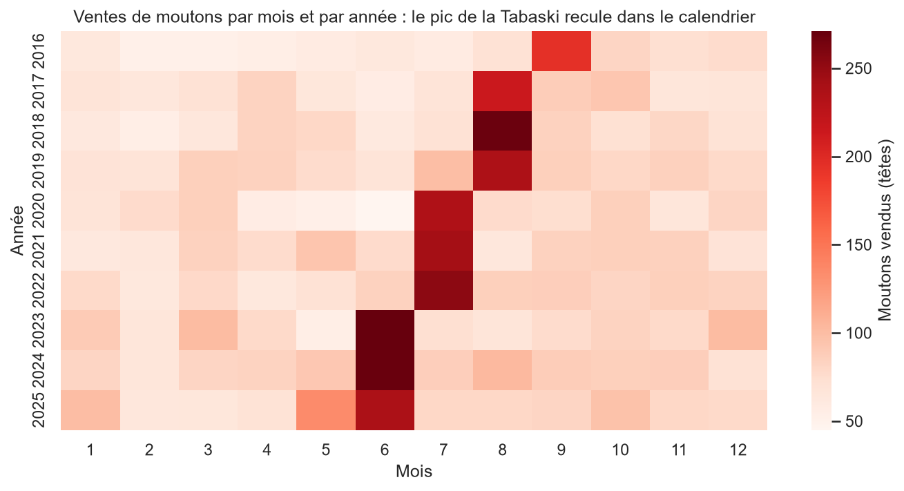
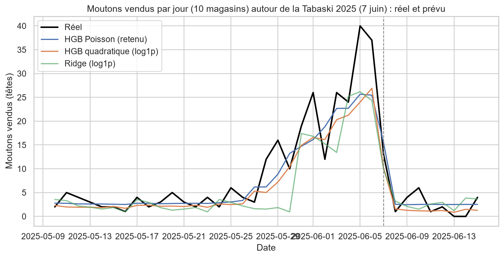

# Fêtes et consommation au Sénégal

**TP4 · Python avancé · Licence 3 Intelligence Artificielle · ISM** — Hamze Abdoulkarim Aden (enseignant : Elias BADJI)

Dix ans de ventes journalières (2016-2025) d'un réseau de 10 points de vente, et une enquête annuelle auprès des ménages, pour mesurer, prévoir et comprendre l'effet des fêtes (Korité, Tabaski, Tamkharit, Magal de Touba, Maouloud, Pâques, pèlerinage de Popenguine, Noël) sur la consommation.

> **Données fictives.** Toutes les données sont simulées à des fins pédagogiques. Elles ne décrivent pas le comportement réel des Sénégalais ni d'aucune communauté religieuse, et aucune conclusion sur une communauté n'est tirée de ce travail.

**Application en ligne :** https://fetes-consommation-senegal.streamlit.app/

## Les quatre questions de la direction

1. **Mesurer** : quels produits s'envolent avant chaque fête, de combien, et dans quelles villes ?
2. **Prévoir** : peut-on prévoir la demande de 2025 avec un an d'avance, alors que les fêtes musulmanes avancent d'environ 11 jours par an ?
3. **Comprendre** : quels ménages s'endettent après une fête, et pourquoi ?
4. **Agir** : quelles quantités prévoir pour les fêtes de 2026 ?

## Résultats clés

**Données.** Après l'audit, 530 790 lignes de ventes deviennent 530 490 lignes : 300 doublons supprimés, 530 libellés de catégorie corrigés, et 1 125 quantités imputées (manquantes, négatives ou aberrantes). Les pics de fête ont été conservés.

**Mesurer.** L'uplift compare la fenêtre J-7 à J-1 à la référence J-60 à J-31. Les plus forts sont ceux de la Tabaski (mouton ×10,4, oignons ×2,8), de la Korité (dattes ×4,1) et de Noël (jouets ×4,0). Le Magal et le Maouloud sont des effets **locaux** : à Touba, le Magal donne une médiane de ×2,0 et le riz monte à ×3,6. Le Maouloud donne ×1,5 à Tivaouane et ×1,4 à Kaolack, alors que Dakar reste proche de 1. Plusieurs uplifts sont faussés par des **chevauchements** : Pâques tombe pendant le Ramadan en 2022-2024, la référence de la Tamkharit contient les achats de la Tabaski, et la Tabaski 2025 tombe deux jours avant Popenguine. Sur dix ans, le CA nominal augmente de 79 %, mais de 37 % seulement en réel (indice de prix de 1,31 en 2025), et de 19 % à périmètre constant. Le paiement mobile passe de 3 % à 48 % du CA. L'effet propre des promotions est de ×1,31, contre ×1,41 en comparaison naïve : c'est un biais de confusion, puisque les promotions sont plus fréquentes avant les fêtes.



**Prévoir.** La Tabaski recule de 10,7 jours par an en moyenne, et son pic de ventes passe de septembre (2016) à juin (2023-2025). Une variable « mois » ne suffit donc pas : il faut les distances en jours aux fêtes (`av_` et `ap_`), calculées avec `merge_asof`.



Le modèle retenu est un HistGradientBoosting avec une **perte de Poisson**, choisie sur la validation 2024. Évalué une seule fois sur 2025, il obtient un **WAPE de 15,9 %**, contre 19,8 % pour la meilleure référence naïve et 16,4 % pour la Ridge. Les pics restent sous-estimés (−21 % sur le mouton avant la Tabaski 2025). Une cible en log1p aggrave ce biais : elle sous-estime le total de 4,3 %, contre 2,0 % avec la perte de Poisson. La régression quantile fournit un stock de sécurité (quantile 90 %), qui ramène les ruptures d'un jour sur deux à environ un jour sur sept.



**Comprendre.** 20,1 % des ménages sont endettés un mois après une fête. Ce taux monte à 44,9 % après la Tabaski, où la dépense médiane atteint 1,5 fois le revenu mensuel, et à 45,9 % quand la fête est financée à crédit. La régression logistique obtient un ROC AUC de 0,821. Retirer la religion et la confrérie ne change pas la performance, mais ces informations restent présentes indirectement dans les autres variables : la religion se retrouve à partir d'elles avec un AUC de 0,999. Une surveillance par groupe reste donc nécessaire. Le K-means sur les dépenses de 2025 fait apparaître 3 profils de ménages.

**Agir.** Le volume prévu pour 2026 est de 6,9 millions d'unités, hors promotions. Les quantités recommandées par fête figurent dans la note de synthèse (`reports/note_synthese_2026.pdf`).

## Arborescence

```
fetes-consommation-senegal/
├── app/
│   ├── app.py                 # tableau de bord Streamlit
│   └── requirements.txt       # dépendances légères pour le déploiement
├── data/
│   ├── raw/                   # les 5 CSV bruts (versionnés)
│   └── processed/             # fichiers parquet intermédiaires (non versionnés)
├── models/                    # modèles joblib (non versionnés)
├── notebooks/
│   └── TP4_Hamze.ipynb        # tout le travail d'analyse, parties 1 à 7 et bonus
├── reports/
│   ├── figures/               # graphiques PNG
│   ├── note_synthese_2026.docx
│   └── note_synthese_2026.pdf # note d'une page pour la direction
├── README.md
├── requirements.txt           # dépendances complètes (versions figées)
└── .gitignore
```

## Installation

Avec Python 3.13, depuis la racine du projet.

Windows (PowerShell) :

```powershell
python -m venv .venv
.\.venv\Scripts\Activate.ps1
pip install -r requirements.txt
```

Linux ou macOS :

```bash
python3 -m venv .venv
source .venv/bin/activate
pip install -r requirements.txt
```

## Exécuter le notebook

Ouvrez `notebooks/TP4_Hamze.ipynb` dans VS Code ou Jupyter avec le noyau `.venv`, puis lancez **Redémarrer et tout exécuter**. En haut du notebook, l'interrupteur `RECALCULER` contrôle les calculs :

- `RECALCULER = True` recalcule tout, du nettoyage aux modèles ;
- `RECALCULER = False` recharge les résultats déjà sauvegardés dans `data/processed/` et `models/`.

Après un clonage du dépôt, ces deux dossiers sont vides, donc tout est recalculé dans les deux cas. Les résultats sont reproductibles (`random_state = 42`). Le notebook génère aussi la note Word `reports/note_synthese_2026.docx`, qu'on exporte ensuite en PDF.

## Lancer l'application Streamlit

En local :

```powershell
streamlit run app/app.py
```

En ligne : https://fetes-consommation-senegal.streamlit.app/

L'application permet de choisir une fête, une ville et une catégorie. Elle affiche les ventes journalières alignées sur le jour de la fête (J0) pour chaque année de 2016 à 2025, ainsi que l'uplift par année.

## Déclaration d'usage d'un assistant IA

Conformément à l'énoncé, je déclare avoir utilisé un assistant IA, Claude (Anthropic), comme tuteur tout au long du TP. Il m'a aidé à organiser le travail, à proposer et expliquer le code, et à interpréter les résultats. J'ai exécuté moi-même tout le code sur ma machine, vérifié les sorties et corrigé les erreurs avec son aide. Les conclusions ont été rédigées à partir des sorties réelles du notebook, et je suis en mesure d'expliquer chaque ligne du code et chaque choix méthodologique.